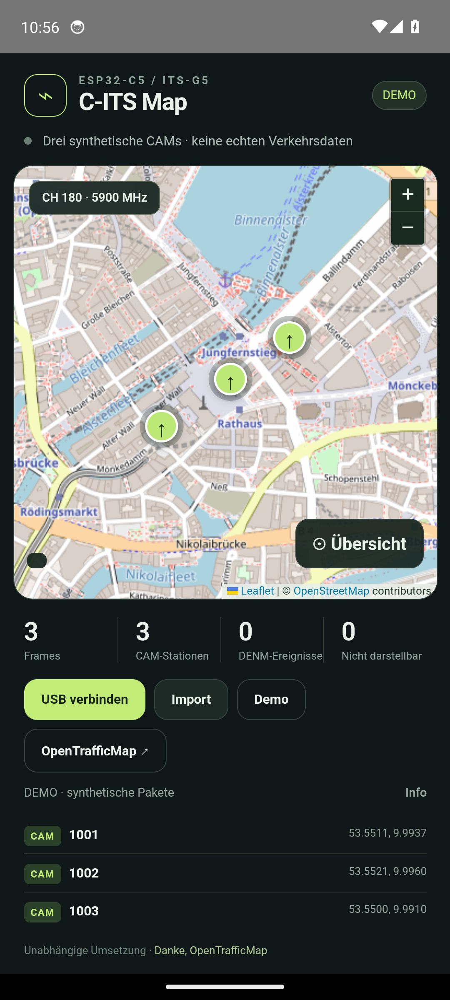

# C-ITS Map · Android / Rust / Dioxus

Unabhängige Android-App für die Waveshare ESP32-C5-Zero-Capture-Firmware in diesem
Repository. Dioxus 0.7.10 stellt die Oberfläche dar; USB-Empfang, Stream-Framing,
PCAP-Import, ETSI-Decodierung und MQTT-Weiterleitung sind in Rust umgesetzt.
Die Karte nutzt lokal mitgeliefertes Leaflet 1.9.4 und OpenStreetMap-Kacheln.

## Funktionen

- ESP32-C5 USB Serial/JTAG (`303a:1001`) über Android USB Host / OTG, ohne Root.
- Android-Dialog für die USB-Gerätefreigabe; Geräteerkennung und Bulk-IN-Lesen
  laufen über die Android-USB-API und JNI, nicht über `/dev/ttyACM*`.
- `CITS:`-Hexzeilen mit Chunk-Reassembly und begrenzter Zeilenlänge.
- Rohe 802.11-Datenframes → LLC/SNAP → GeoNetworking → BTP → ASN.1 UPER.
- CAM v1.4.1 sowie DENM v1.3.1 / v2.2.1 über `c-its-parser` 2.4.2.
- Positionen, Stations-ID, CAM-Geschwindigkeit und Richtung; DENM-Ereignisse
  werden anhand von Action-ID und Sequenznummer unterschieden. Abmeldungen
  entfernen das passende Ereignis.
- Aktualisierung vorhandener Marker; lokale Anzeigezeiten 60 s für CAM und
  5 min für DENM, maximal 512 Objekte. Das ist eine Anzeigeheuristik, keine
  vollständige Auswertung aller ETSI-Gültigkeitsbedingungen.
- Log-/PCAP-Import bis 8 MiB. Unterstützt wird klassisches PCAP 2.4 mit Linktyp
  105 in beiden Byte-Reihenfolgen. PCAPNG/Radiotap bitte vorher konvertieren.
- Demo mit drei synthetisch codierten CAM-Paketen durch dieselbe Decoderpipeline.

## Auf OpenTrafficMap anzeigen

Die lokale Karte funktioniert unabhängig von einem OpenTrafficMap-Account.
Für die öffentliche Karte:

1. Eigene Node-ID bei OpenTrafficMap registrieren bzw. mit den Betreibern klären:
   [Node Registration](https://wiki.opentrafficmap.org/en:node_registration).
2. ESP32-C5 am Android-Gerät anschließen und **USB verbinden** wählen.
3. **OpenTrafficMap ↗** öffnen, eigene Node-ID eintragen und **Livepakete teilen**
   aktivieren. Erst diese Aktion startet die Netzwerkverbindung.
4. **Öffentliche OpenTrafficMap öffnen ↗** wählen.

Die App verwendet das in der Originalfirmware vorgegebene Format:
TLS/MQTT an `cits1.opentrafficmap.org:8883`, Topic `its/<node-id>/packet`,
unveränderte rohe 802.11-Bytes, QoS 0, kein Retain.
Quellen: [MQTT-Implementierung](https://codeberg.org/opentrafficmap/its-g5-receiver-firmware/src/branch/main/main/mqtt.cpp),
[Broker-Konfiguration](https://codeberg.org/opentrafficmap/its-g5-receiver-firmware/src/branch/main/main/config.c).
Die Android-App abonniert keine Fernsteuerungs-Topics und veröffentlicht keine
erfundenen Empfängerkoordinaten. Serverannahme, Node-Zuordnung und öffentliche
Anzeige hängen von OpenTrafficMap ab und werden nicht durch einen lokalen
„gesendet“-Zähler bestätigt.

Weitergeleitete Pakete enthalten die ausgesendeten Stations- und Positionsdaten
und können öffentlich sichtbar werden. Die Weiterleitung ist standardmäßig aus
und wird beim Trennen der USB-Verbindung beendet. Nur neu empfangene Livepakete
werden weitergeleitet, niemals Demo- oder Importpakete. Die Queue ist begrenzt;
bei Netzwerkfehlern endet die Weiterleitung, statt alte Pakete später nachzusenden.
Für einen neuen Versuch die Weiterleitung aus- und wieder einschalten.

## APK bauen

Voraussetzungen: Rust stable mit `aarch64-linux-android`, Dioxus CLI 0.7.10,
Android SDK mit Plattform 36 und Build Tools, NDK und ein mit Gradle kompatibles
JDK (empfohlen JDK 17).

```bash
cd android-app
rustup target add aarch64-linux-android
cargo install dioxus-cli --version 0.7.10 --locked
export JAVA_HOME=/pfad/zum/jdk17
export ANDROID_HOME="$HOME/Android/Sdk"
# Optional: eine bestimmte NDK-Version wählen:
export ANDROID_NDK_HOME="$ANDROID_HOME/ndk/27.2.12479018"
./scripts/build-android.sh
```

Ergebnis: `dist/cits-map-0.1.0-android-arm64.apk` plus SHA256-Datei.
Rust wird im Release-Profil gebaut. Die APK ist für die lokale Installation mit
dem Android-Debugschlüssel signiert, nicht für eine Play-Store-Veröffentlichung.
Das Skript ergänzt reproduzierbar das USB-Host-Feature im generierten Manifest
und einen identifizierbaren WebView-User-Agent für die Kartenanfragen.

Installation:

```bash
adb install -r dist/cits-map-0.1.0-android-arm64.apk
```

Alternativ die APK auf dem Telefon öffnen. Das Telefon muss USB-Host/OTG unterstützen
und das Board mit Strom versorgen können. Die App braucht keinen Standortzugriff,
weil Positionen aus den Funkpaketen stammen. Internetzugriff wird für Kartenkacheln
und für eine aktivierte OpenTrafficMap-Weiterleitung verwendet.

Ein direkter `dx build` allein enthält die nachgelagerten Manifest-/User-Agent-
Anpassungen nicht. Für die zu installierende APK das Buildskript verwenden.

## Tests

```bash
cargo test --locked
cargo check --locked --features desktop
```

Die Integrationstests erzeugen gültige ASN.1-Pakete und prüfen deren Weg von
WLAN/USB/PCAP bis zu den Kartenobjekten, beschädigte Eingaben, Ereignisabmeldungen,
Ablauf und Speichergrenzen. Öffentliche MQTT-Paketveröffentlichungen erfolgen in
Tests nicht. Der Zustand der Hardware-/Emulatorprüfung wird im
[Testbericht](TEST-REPORT.md) festgehalten.

## Grenzen

- Signaturen werden nicht kryptografisch geprüft. Die Anzeige ist ein
  Forschungswerkzeug und keine verlässliche Verkehrs- oder Gefahrenwarnung.
- Nicht unterstützte Nachrichtentypen werden gezählt, aber nicht dargestellt.
  Solche gültigen WLAN-Frames können bei aktivierter Weiterleitung dennoch
  vom OpenTrafficMap-Backend verarbeitet werden.
- Kein Reassembly fragmentierter 802.11-Frames, kein A-MSDU, keine WLAN-Verschlüsselung.
- Kein garantierter Hintergrundbetrieb/Foreground-Service, keine Offlinekarten,
  keine automatische Neuverbindung und keine dauerhafte Paketspeicherung.
- Zeitangaben sind lokale Verarbeitungszeiten. PCAP-Funkzeitstempel werden beim
  Import nicht für die Lebensdauer der Kartenmarker verwendet.
- Kartenkacheln erfordern Internet; der Paketdecoder funktioniert unabhängig davon.
  Keine Kacheln vorladen oder massenhaft herunterladen.

## Anerkennung und Lizenzen

Vielen Dank an die OpenTrafficMap-Mitwirkenden für ihre Grundlagenarbeit bei
günstigem C-ITS-Empfang, ESP32-C5-Firmware, Paketweiterleitung und öffentlichen
Verkehrskarten. Dieses Projekt ist keine offizielle OpenTrafficMap-Veröffentlichung.

- [OpenTrafficMap](https://opentrafficmap.org)
- [OpenTrafficMap-Organisation und Original-Repositories](https://codeberg.org/opentrafficmap)
- [C-ITS Parser](https://github.com/consider-it/C-ITS-Parser) · MIT
- [Dioxus](https://github.com/DioxusLabs/dioxus) · MIT / Apache-2.0
- [Leaflet](https://leafletjs.com/) · BSD-2-Clause, Lizenz unter `assets/vendor/Leaflet-LICENSE`
- [OpenStreetMap](https://www.openstreetmap.org/copyright) · Kartenattribution bleibt sichtbar

Die bestehende ESP-Firmware verwendet weiterhin den im Hauptprojekt dokumentierten
`esp32-cits-core`. Die Android-App kopiert keinen OpenTrafficMap-Firmwarecode;
sie implementiert den öffentlich einsehbaren MQTT-Pakettransport.

## Emulator-Smoke-Test wiederholen

Für einen dedizierten Android-14-Emulator (x86-64, mit WebView) kann zusätzlich
folgendes ausgeführt werden. Das Skript startet die installierte App neu und
bedient ihre Oberfläche über den WebView-Debugging-Endpunkt.

```bash
# Im Verzeichnis android-app:
./scripts/build-android.sh x86_64-linux-android
adb -s emulator-5554 install -r dist/cits-map-0.1.0-android-x86_64.apk
cd ..
mkdir -p test-results
python3 -m venv /tmp/cits-ui-tests
/tmp/cits-ui-tests/bin/pip install -r android-app/tests/requirements.txt
cargo run --manifest-path android-app/Cargo.toml --example demo_log > test-results/demo-input.log
/tmp/cits-ui-tests/bin/python android-app/tests/emulator_smoke.py
```

`ANDROID_SERIAL` und `ADB` können bei Bedarf gesetzt werden. Der Test verwendet
Port 9223 zur lokalen WebView-Inspektion und entfernt die Weiterleitung anschließend.
Er benötigt eine debug-signierte APK; ein physischer USB-Empfänger ist nicht Teil
dieses Emulator-Tests.


